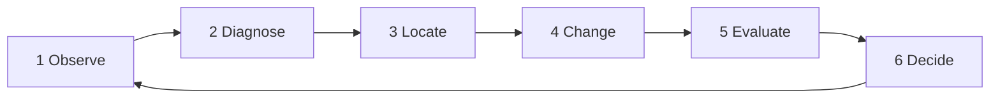

# Court calibration: methodology

Calibration finds the **homography**, a 3×3 matrix that maps court positions in metres to pixels in the photo (and back). This note explains how the algorithm works, what data it was tested on, and how it was improved and measured. The results are in `report.md`.

Court coordinates are in metres with the origin at the far-left doubles corner: x runs across the court (0–10.97 m) and y along it (0–23.77 m).

## 1. The algorithm, step by step

All of this is `CourtMapper.auto_calibrate` in `court.py`.

| Step | What happens | Code |
|---|---|---|
| 1. Resize | Shrink the photo to 960 px wide so the settings behave the same on any photo. | `_working_image` |
| 2. Find paint | Mark pixels that are thin, bright and not strongly coloured, i.e. white lines. Give up if more than 35% of the frame is marked, because the photo is then too washed out to trust. | `_line_mask` |
| 3. Detect lines | Find straight line segments in the paint mask. | `_detect_lines` (Hough transform) |
| 4. Group lines | Sort the lines into two groups: lines *across* the court (baselines, service lines) and lines *along* it (sidelines, centre line). Several alternative groupings are produced (see section 2). | `_detect_lines`, `_vanishing_point_families` |
| 5. Propose courts | Build candidate courts from the line groups (see section 3). | `_candidate_quads` |
| 6. Score each proposal | Draw every court marking onto the photo using the proposal's homography and measure how much of it lands on paint. The best score wins. | `_score_projection` |
| 7. Refine the winner | Nudge the winning proposal so every marking sits exactly on the paint (see section 6). | `_refine` |
| 8. Finish | Scale back to full resolution and store the homography, or report failure if even the best score is too low. | end of `auto_calibrate` |

## 2. Line detection, grouping and assignment

- **Detection (step 3):** a Hough transform on the paint mask returns straight segments longer than about 6.5% of the frame width.
- **Grouping (step 4)** answers "which lines belong together?". There are two methods, and both are used:
  - **By angle.** Lines within 24° of horizontal go in the *across* group. Lines steeper than 40° go in the *along* group, if they are tall enough. Lines between 24° and 40° are ambiguous: they are offered to both groups, but only fill places left over after the clear-cut lines. Each group keeps at most 14 lines, longest first, with near-duplicates removed.
  - **By vanishing point.** Lines that are parallel on the court meet at a single point in the photo, however steep they look. The three points with the most supporting lines are found, and each pair of them defines two groups. This is what handles close, oblique cameras such as Hanoi's, where a sideline can look almost horizontal.
- **Assignment** answers "which group is the baselines and which the sidelines?". It isn't decided up front. Each vanishing-point pairing is tried both ways round, and scoring (step 6) keeps whichever assignment fits the markings. Which *specific* line is the doubles sideline, the singles sideline and so on is decided the same way: by which proposal scores best.

## 3. How the initial calibration proposal is generated

1. Take **every pair of *across* lines** and **every pair of *along* lines**, for every grouping from section 2.
2. Intersect them to get four corners, a quadrilateral.
3. Discard quadrilaterals that can't be a court seen from a camera: corners too far outside the frame, not convex, too small, implausible top-to-bottom width ratio, and so on.
4. Match each surviving quadrilateral to each of three **court layouts**, i.e. which real court rectangle the four corners represent:
   - **full:** both baselines. Used when the whole court is in view.
   - **near:** near service line to near baseline. Used when the camera is behind a baseline.
   - **half:** net to near baseline.
5. Each quadrilateral–layout pair gives a homography directly from its four corner correspondences. That homography is one **proposal**. A typical photo produces 500–4,000.

**How a proposal is scored.** Sample 70 points along every painted marking of the layout, project them into the photo, and look up how far each lands from the nearest paint pixel. Each point contributes `exp(−(distance / 3 px)²)`: 1 on the paint, falling to nearly 0 beyond about 6 px. The score is the weighted average of those contributions, from 0 to 1. Then:

- If part of the court is outside the frame, only the visible points count. At least 60% must be visible, the score must reach at least 0.6, and it is reduced in proportion to how much is hidden.
- Layouts get a small preference on near-ties: full × 1.0, near × 0.93, half × 0.92.
- The highest-scoring proposal wins. If its score is below 0.30, calibration returns "failed" rather than a guess.

## 4. The dataset

**Location:** the photos are in `tennis_analytics/dataset/`. Everything derived from them is in `tennis_analytics/calib_report/`.

| Photo | Size (px) | Type | Ground truth? |
|---|---|---|---|
| `court.png` | 1657 × 915 | Broadcast frame, hard court | yes |
| `court_wimbledon_no1_grass.jpg` | 1600 × 1063 | Stadium, grass | yes |
| `court_delhi_centre_hard.jpg` | 2335 × 1290 | Stadium, elevated side camera | yes |
| `court_arthur_ashe_hard.jpg` | 798 × 783 | Stadium, overhead | yes |
| `court_naples_universiade_clay.jpg` | 2217 × 859 | Stadium, clay | yes |
| `court_hanoi_times_city_hard.jpg` | 1600 × 1200 | Club court, close oblique camera, corner out of frame | yes |
| `court_val_doingt_hard.jpg` | 2400 × 1065 | Club court, elevated corner view | no, judged by eye |

**Information stored per sample:**

| File | Contents per photo |
|---|---|
| `tools/common.py` (`PHOTOS`) | file name and display title |
| `reference_seeds.json` | the rough starting point for the ground truth: either hand-picked court↔pixel point pairs, or an existing calibration checked by eye |
| `references.json` | the **ground truth**: a 3×3 court-to-pixel homography, and the list of court lines it was fitted to |
| `references/<photo>_ref.jpg` | the ground truth drawn over the photo, for checking |
| `stages/<stage>/metrics.json` | for each stage: calibrated or not, layout chosen, score, run time, the homography found, and its error against ground truth (median, 95th percentile, fraction of court visible; near and far half) |
| `stages/<stage>/overlays/` | the calibrated singles court drawn over the photo |

**How the ground truth is made** (`tools/reference.py`), independently of the algorithm's line search and scoring:

1. Start from the seed.
2. For each of the nine court lines on its own, take the white-paint pixels in a narrow band around where the seed puts it, and fit a straight line. Clutter is removed by repeatedly refitting on only the pixels closest to the previous fit.
3. Solve the homography from all intersections of *across* and *along* lines. RANSAC throws out lines that snapped to the wrong marking.

It is trusted to about 5 cm: two paint-detection settings give references within 2–5 cm of each other, and the line spacing along each sideline matches regulation proportions.

## 5. The stages in the improvement loop

1. **Observe.** Look at the singles-court overlay for every photo and spot the fits that don't sit on the paint.
2. **Diagnose.** Score the *correct* court by hand and compare it with the chosen one. Higher means the search never proposed the correct court. Lower means the scoring prefers a wrong one.
3. **Locate.** Draw the output of each algorithm step for that photo: mask, lines, groups, proposals. Find the exact step where the correct court is lost. For example, Delhi's sideline was at 31°, just under the old 32° cutoff.
4. **Change.** Make one targeted edit aimed at that cause.
5. **Evaluate.** Run the edited code on **every** photo (`tools/run_stage.py`), and save it as a new stage with its code, overlays and errors.
6. **Decide.** Keep the change if it is better against ground truth and breaks nothing else. Otherwise revert it and record it as rejected. Turning a refusal into a wrong fit counts as breaking something.

Nine stages were recorded (`stages.json`): the baseline (00) and eight changes (01–08), of which six were kept and two rejected. Four of the changes had side effects on other photos, and each was caught at step 5.

## 6. How a proposal is updated (refinement)

The winning proposal is based on only four line intersections, so small errors in those lines skew the whole court. Refinement (`_refine`) corrects this using every marking, for up to three passes:

1. Project the 70 sample points of every marking with the current homography.
2. Keep the points that land near paint. The search radius shrinks each pass: 9, then 7, then 4.5 px.
3. Pair each kept point with its nearest paint pixel.
4. Solve a new homography from all the pairs, using RANSAC to ignore bad pairs.
5. Accept it only if the court outline is still plausible and the score went up. Otherwise stop and keep the previous one.

On a real run this moves the fit by a few centimetres. For example, Delhi goes from 9 to 7 cm and Hanoi from 12 to 11 cm. `figures/pipeline/<photo>/` shows each pass, including a demonstration that starts from a deliberately nudged fit.

## 7. How a calibration is measured against the ground truth

Both the product and the ground truth are homographies, made in two different ways:

- **The calibration being tested** is the product: `auto_calibrate` in `court.py`. It must find the court with no human help, on any photo, in well under a second.
- **The ground truth** is a grading tool: `tools/reference.py`. It is made offline, one photo at a time, starting from a human-picked or human-checked seed. It only fine-tunes a court it has already been pointed at, so it can't replace the product, whose hard part is finding the right court among thousands of candidates.

The two work like a model's predictions and labelled test data.

The algorithm's own score is **not** used for this, because it can be high for a wrong fit. Instead (`ground_error` in `tools/common.py`):

1. Lay a grid of court points every 25 cm over the court.
2. Place them in the photo using the **ground-truth** homography, and keep only those that fall inside the frame.
3. Map those pixels back to the court using the **calibration being tested**.
4. The error for each point is the distance, in cm, between where the calibration says it is and where it really is.
5. Report the **median** and **95th percentile**, separately for the near half and the far half. The far half is often extrapolated, so it is expected to be worse.

How to read the numbers:

- **Wrong fit:** a near-half median over 50 cm means the fit landed on the wrong lines.
- **Noise:** differences under about 5 cm are within the ground truth's own uncertainty.
- **Refused:** the algorithm returned no calibration, which is preferred to a wrong one.
