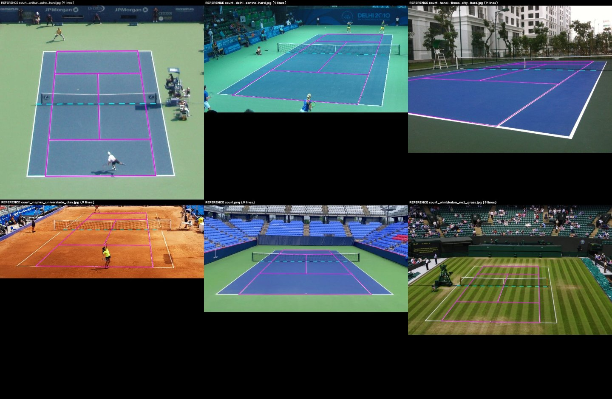
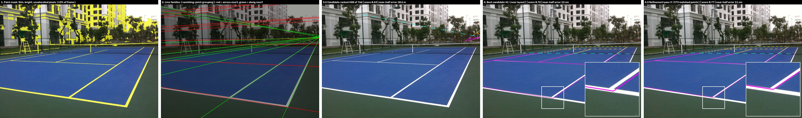
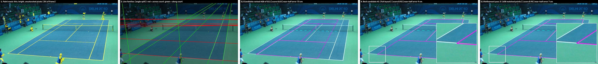
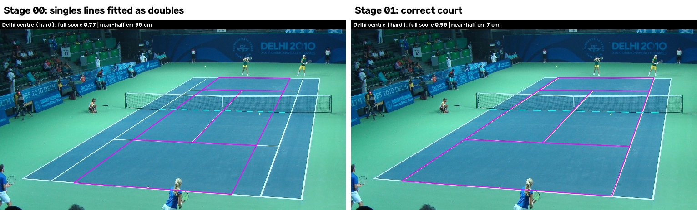
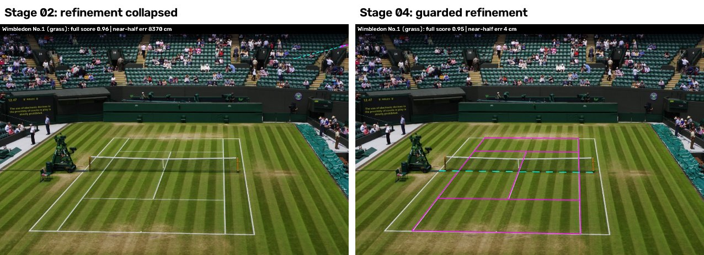
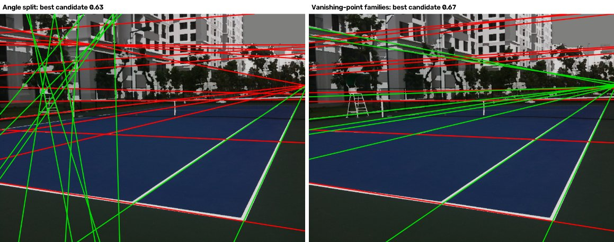
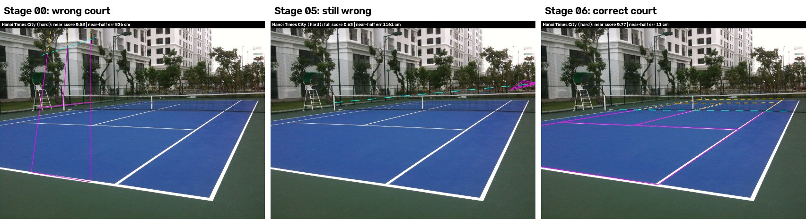
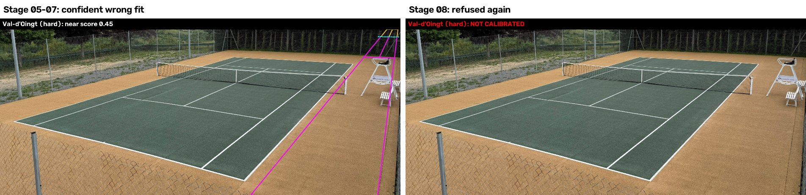
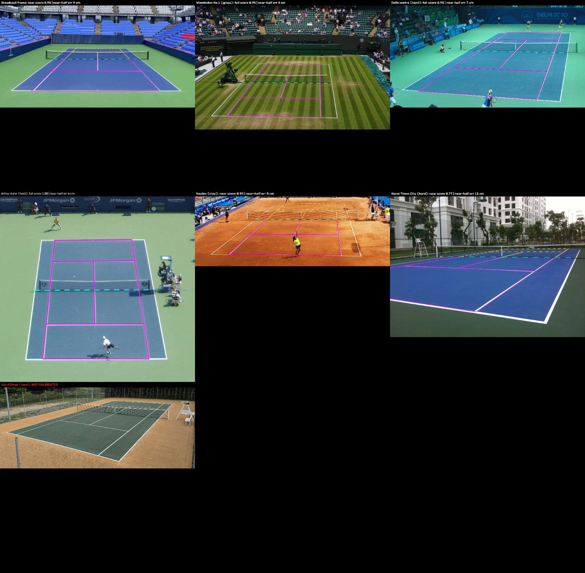

# Automatic tennis-court calibration: robustness improvements

## Summary

Automatic calibration maps image pixels to court positions in metres by finding the painted court lines. On a seven-photo test set, two photos were calibrated onto the wrong lines. Both are now fixed, and nothing else changed:

- **Delhi (hard, stadium):** the singles sidelines were fitted as doubles sidelines. Near-half ground error went from **95 cm to 7 cm**.
- **Hanoi (hard, club court, close oblique camera):** the fit landed on a completely wrong court. Near-half error went from **8.3 m to 11 cm**.
- **The other four calibrated photos** give results identical to before.
- **Val-d'Oingt** is still refused. Returning no calibration is the correct behaviour while the method can't handle this photo.
- Runtime is at most 0.4 s per photo, up from at most 0.2 s.

Eight changes were tried, one at a time. Six were kept and two rejected. Each was measured against hand-verified ground-truth calibrations, with an overlay image saved for every photo at every stage.

## How calibration quality was measured

**Ground-truth reference.** For each photo a reference homography was built without using the calibration code's line search or scoring:

1. Start from a rough initial fit. For Hanoi this was five hand-picked points; for the others, the existing calibration after checking it by eye.
2. Snap each of the nine painted lines on its own: take white-paint pixels in a narrow band around the rough position and fit a straight line robustly.
3. Solve the homography from every baseline/service-line × sideline intersection, using RANSAC to drop lines that snapped to the wrong marking.

**Error metric.** Place a 25 cm grid of court points in the photo using the reference. Map those pixels back to the court with the calibration under test and measure the distance from the true point. The tables report the **median / 95th percentile in cm**, separately for the near half and the far half, counting only the part of the court that is in frame. For a camera behind one baseline the far half is extrapolated, so larger far-half errors are expected.

**How far to trust the reference.**

- Rebuilding the references with two different paint-mask settings moves them by at most 2 cm on four photos, and by 4–5 cm (median) on Hanoi and Naples.
- The perspective-invariant cross-ratio of the four transverse lines matches the regulation value (1.099) to within 0.01 on every sideline except Naples' right one (1.125).

**Differences below about 5 cm are within reference noise.** Val-d'Oingt has no reference: its lines don't fit one standard-court homography to better than about 10 px, possibly because of lens distortion. Its fits were judged by eye.



## How one calibration run works

Each panel below comes from replaying the final `court.py` on one photo, and the replay is checked against the real result. The label on each panel gives the calibration score and the near-half ground error.

1. **Paint mask.** Keep thin, bright, weakly saturated structures (yellow).
2. **Line families.** Find straight lines in the mask and group them into lines across the court (red) and lines along it (green), by angle or by vanishing point.
3. **Search.** Every pair of red lines combined with every pair of green lines gives a candidate court: 766 for Hanoi, 511 for Delhi. Each candidate is scored by projecting the full set of court markings and measuring how much of it lands on paint. Almost all candidates are metres out. The search works because the correct court scores clearly highest, not because scores improve smoothly: for Hanoi, candidate #1 is 12 cm out, while #2 is 12 m out.
4. **Best candidate.** Its corners come from just four line intersections.
5. **Refinement.** Each pass matches every projected marking to its nearest paint pixel and re-solves the homography. On a real run this moves the fit only a few centimetres, so the panels include a magnified inset of the spot that moves most.





To make refinement visible at a larger scale, a demonstration moves each corner of the final fit about 8 px (in the 960 px working image) off the paint, then runs the same three refinement passes. On Delhi the near-half error goes 30 → 21 → 19 → 17 cm. On Hanoi it goes 28 → 11 → 9 → 7 cm.

Per-step panels, a grid and two animated GIFs (`pipeline.gif` for the search and refinement, `refinement_demo.gif` for the demonstration) are in `figures/pipeline/<photo>/` for Hanoi, Delhi, Naples and Wimbledon.

## Results by stage

Each cell is the near-half ground error as median / 95th percentile, in cm. "Wrong" means the fit landed on the wrong lines (near-half median over 50 cm).

| Stage | Kept | Broadcast | Wimbledon | Delhi | Arthur Ashe | Naples | Hanoi | Val-d'Oingt |
|---|---|---|---|---|---|---|---|---|
| 00 Baseline | – | 9 / 16 | 4 / 5 | **wrong** (0.9 m) | 6 / 9 | 5 / 18 | **wrong** (8.3 m) | refused |
| 01 Ambiguous-angle band | yes | 9 / 16 | 4 / 5 | 7 / 18 | 6 / 9 | 8 / 14 | **wrong** (8.3 m) | refused |
| 02 Refine top 8 candidates | no | 9 / 16 | **wrong** (84 m) | 9 / 13 | 6 / 9 | 8 / 14 | **wrong** (8.3 m) | refused |
| 03 Band lines fill leftover slots | yes | 9 / 16 | 4 / 5 | 7 / 18 | 6 / 9 | 5 / 18 | **wrong** (8.3 m) | refused |
| 04 Refinement outline guard | yes | 9 / 16 | 4 / 5 | 7 / 18 | 6 / 9 | 5 / 18 | **wrong** (8.3 m) | refused |
| 05 Score partially visible courts | yes | 9 / 16 | 4 / 5 | 7 / 18 | 6 / 9 | 5 / 18 | **wrong** (12 m) | wrong fit (by eye) |
| 06 Vanishing-point line families | yes | 9 / 16 | 4 / 5 | 7 / 18 | 6 / 9 | 5 / 18 | 11 / 42 | wrong fit (by eye) |
| 07 Refine against far half too | no | 10 / 19 | 4 / 5 | 7 / 18 | 6 / 9 | 5 / 17 | 10 / 33 | wrong fit (by eye) |
| 08 Stricter bar for partial views | yes | 9 / 16 | 4 / 5 | 7 / 18 | 6 / 9 | 5 / 18 | 11 / 42 | refused |

Baseline compared with the final version, near and far halves (median / 95th percentile, cm):

| Photo | Before: near | After: near | Before: far | After: far |
|---|---|---|---|---|
| Broadcast | 9 / 16 | 9 / 16 | 13 / 35 | 13 / 35 |
| Wimbledon | 4 / 5 | 4 / 5 | 4 / 5 | 4 / 5 |
| Delhi | **wrong** (0.9 m) | 7 / 18 | **wrong** (0.9 m) | 13 / 23 |
| Arthur Ashe | 6 / 9 | 6 / 9 | 4 / 6 | 4 / 6 |
| Naples | 5 / 18 | 5 / 18 | 31 / 58 | 31 / 58 |
| Hanoi | **wrong** (8.3 m) | 11 / 42 | **wrong** (18 m) | 120 / 213 |
| Val-d'Oingt | refused | refused | refused | refused |

## What changed at each stage, and why

In the overlays, magenta is the calibrated singles court. Orange dashes mark the far half where a half-court fit extrapolates it, and cyan dashes mark the net line.

### Delhi: a sideline mistaken for a baseline (stages 01–04)

**Cause.** Calibration builds candidate courts from pairs of "baseline-like" and "sideline-like" lines, split at a fixed 32° from horizontal. Seen from Delhi's elevated side camera, the left doubles sideline lies at 31°, so it was filed as a baseline. A court using the true doubles sidelines was never a candidate. The best remaining option was the singles sidelines, and the fit had to stretch them to doubles width.

**Stage 01, kept.** Lines between 24° and 40° are offered in both roles, and whole-layout scoring picks the role. Delhi's near-half error dropped from 95 cm to 7 cm.



**Stage 02, rejected.** Refining the eight best candidate courts, instead of only the best one, let the refinement on Wimbledon collapse the whole court onto one patch of paint. That fit scored higher (0.964) and was 84 m out.



**Stage 03, kept.** In stage 01 the long band lines crowded Naples' shorter service line out of the capped list of line candidates. Band lines now only fill slots left free by unambiguous lines, which restores Naples' original fit.

Measured against the reference, the two Naples fits are equivalent on the near half (5 / 18 vs 8 / 14 cm). The stage-01 fit was actually better on the far half (22 vs 31 cm median). This stage was chosen on calibration score, not accuracy; see the limitations below.

**Stage 04, kept.** Every refinement step must still produce a plausible court outline. It is a safety net against the stage-02 collapse and changes no current result.

### Hanoi: a close, oblique club-court camera (stages 05–08)

Two things stopped the correct court from ever being considered.

**The court runs out of frame.** The near-left baseline corner is 590 px outside a 960 px-wide working image, and 21% of the court's markings are off-frame. Candidates could have corners at most 25% of the frame width outside, and needed 97% of their markings in view to be scored at all. Scored on its visible markings alone, the true fit reaches 0.91, well above the wrong fit's 0.58.

**The left sidelines look horizontal.** From a camera beside the near corner, the left sidelines appear within about 7° of horizontal, so any angle-based split files them as baselines.

**Stage 05, kept but not enough on its own.** A court with up to 40% of its markings outside the frame is scored on the markings in view, with a proportional penalty, and corners may lie further outside the frame. Hanoi still failed, because of the second problem.

**Stage 06, kept.** Lines are also grouped by the vanishing point they run towards. Lines parallel on the court meet at one image point however steep they look. Scenery has its own vanishing points, such as the building's verticals, so the three strongest are paired up in both roles and layout scoring decides. The original angle split is kept as one of the groupings, which is why the other photos are unchanged. Hanoi's near-half error dropped from 8.3 m to 11 cm.





**Stage 07, rejected.** Refining half-court fits against far-half markings in view as well helped Hanoi (far half 120 → 94 cm) and Naples (31 → 26 cm). It hurt the broadcast frame (far half 13 → 17 cm, near half 9 → 10 cm), so the net effect was mixed.

**Stage 08, kept.** Stage 05 had a side effect: Val-d'Oingt, previously refused, got a confident wrong fit that lay mostly outside the frame. A partially visible court must now reach a raw score of 0.6, against 0.77 for the correct Hanoi fit. Val-d'Oingt is refused again.



### Final state, all photos



## Limitations and next steps

- **Hanoi's far half is 1.2 m out (median), and its near half reaches 42 cm (95th percentile) close to the net.** The far half is extrapolated from a very close, low camera, where lens distortion and thin distant lines count most. Refining against far-half markings (stage 07) helped here and could return as a per-photo choice, if a reliable way to decide when to use it can be found.
- **The calibration score is not a reliable measure of accuracy.** On Naples the lower-scoring fit was more accurate on the far half. On Wimbledon (stage 02) the highest score of all was an 84 m error. Decisions should be checked against the reference harness, not the score.
- **Val-d'Oingt:** the sand-coloured surround passes the paint test and covers 29% of the frame, and the photo has no consistent reference yet.
- **Coverage:** seven photos, with semi-automatic references. More venues and camera positions, especially real match video frames, are needed before drawing broad conclusions.

## Reproducing

All artefacts are in `tennis_analytics/calib_report/`:

- `stages/NN_name/`: the `court.py` snapshot for that stage, `overlays/` for every photo, `sheet.jpg` and `metrics.json`
- `references.json`, `references/`: ground-truth homographies and their overlays
- `tools/`: `reference.py` builds the references, `run_stage.py` evaluates a stage, `summarize.py` builds the tables and figures, `make_history.py` recreates stages 00–04

```bash
cd tennis_analytics/calib_report
python tools/reference.py                 # ground truth
python tools/run_stage.py stages/0*       # evaluate every stage
python tools/summarize.py                 # tables + figures
```
